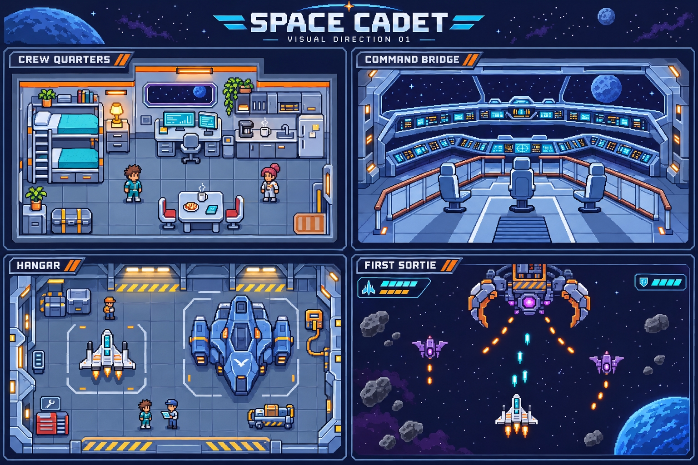

# Space Cadet — visual direction 01

Status: design exploration based on the user's seven reference images. An initial playable preview now exists; see the [implementation plan](../../../SPACE_CADET_PLAN.md). The concept board is a mood and composition reference, not a production asset sheet or final gameplay screenshot.

The first implementation uses a deliberately smaller Canvas pixel-art set. Actual preview captures: [desktop quarters](first-playable-desktop.png) and [phone hangar](first-playable-mobile.png). Further art passes should add richer material shading, more character features, environmental animation, and a full shared tileset while retaining the tested collision layout and readable controls.

## The feel

A place you want to live aboard, and a frontier you want to explore. Crisp 16-bit pixel art, practical machinery, and a crew with personal belongings. Quiet quarters and familiar faces give the action emotional weight. Becoming a hero should change your surroundings as well as your ship's stats.

Keep original ship designs, room arrangements, characters, and insignia. The supplied references guide the style; their lettering, watermarks, and asset sheets do not become game assets.

## What each reference contributes

| User reference | Direction to retain |
| --- | --- |
| command control.jpg | A panoramic viewport, pale blue structural layers, curved consoles, and three clear command stations |
| living spaces.png | Small functional living zones, cyan screens, kitchen appliances, warm trim, and an open tiled floor |
| room.png | Cutaway walls and furniture that tell you how the space is used without dialogue |
| room12.png | A recognizable personal bunk, strong door silhouette, and an entrance with a clear walking route |
| space crib.jpg | A substantial carrier that feels like a home, with identifiable docking and observation areas |
| spaceships.png | Ship classes recognizable from silhouette and proportions, with readable cockpit and engine placement |
| basic mode.avif | Clear top-down combat sprites, sparse stars, distinct planets and rocks, and visible projectile families |

The room crops share one visual family. Use them as a unified interior direction rather than three competing styles.

## Camera and pixel rules

- Playable interiors: overhead cutaway view with visible upper walls and shallow furniture fronts. Use the same perspective for quarters, engineering, training, hangar, and the playable bridge.
- Panoramic bridge: a separate establishing shot or conversation backdrop. The board's bridge panel is frontal; it must not imply that walking characters use that perspective.
- Combat: top-down sprites in the first release. Carrier exterior: a separate three-quarter establishing illustration. These views serve different scenes and must not mix inside one gameplay map.
- Proposed production baseline: 480 × 270 logical pixels for the playfield, 16 × 16 floor tiles, and cadet sprites within roughly 24 × 32 pixel frames. Prototype legibility before freezing these sizes.
- Author scenery and characters on one shared pixel grid. Scale to integer multiples where space allows, use nearest-neighbor sampling, and letterbox rather than stretch the world. Responsive menus and dialogue can render independently at readable screen resolution.
- Hard-edged pixel clusters, three or four tones per material, and deliberate highlights. No smoothing filters or blurred shadows. The generated board suggests the look; its pixel grid and shading still need production cleanup.

## Palette proposal

| Role | Color | Use |
| --- | --- | --- |
| Deep space | `#0B1330` | Exterior backgrounds and negative space |
| Hull shadow | `#26364D` | Wall outlines and recessed machinery |
| Steel deck | `#59758B` | Floors and midtone structures |
| Ice-blue hull | `#BCDCEB` | Friendly ships and lit architectural edges |
| Instrument cyan | `#36D8F2` | Navigation screens, shield feedback, friendly fire |
| Habitation amber | `#FFBD59` | Lamps, inhabited windows, welcoming room accents |
| Hazard orange | `#FF722B` | Hangar stripes, danger indicators, hostile shots |
| Alien violet | `#A56BDD` | Enemy cores, hull accents, unknown technology |

Use dark outlines and different shapes alongside color: narrow cyan player bolts, round orange hostile shots, a shield-shaped defense pickup, and a wrench-shaped repair pickup. Preserve the player's own character colors rather than forcing everyone into teal.

## Interiors and daily life

**Crew quarters:** bunk, locker, desk, kitchenette, a mug, a small plant, and a viewport. Personal details stay near walls; the central floor stays usable. The recruit starts with a plain bunk and gradually earns decorations and mission keepsakes.

**Engineering:** exposed service panels, large readable power conduits, tool storage, and a damaged relay as the first puzzle. Indicate interactable equipment with a small animated bracket and a nearby prompt rather than making every screen flash.

**Training deck:** clean lanes, target drones, floor markers, and a simulator pod. A player should identify where to stand and what to practice immediately.

**Hangar:** docking pads, fuel connections, maintenance carts, safe paths, and the actual selected ship. The hangar sprite and flight sprite share the same hull design. Larger ships need larger pads; the board only establishes relative visual weight, not final physical scale.

**Bridge:** horseshoe consoles, three officer stations, a clear central aisle, and a wide viewport. Reserve a place for each crew member; neither characters nor chair collision boxes can block the only exit.

Layout target: main walking lanes at least three tiles wide, two-tile door openings, a clear interaction position for every job, and space beside NPCs. Draw legs behind desks with foreground layers while keeping collision on the floor footprint. NPCs do not wander onto the player's required task location.

## Character adaptation

Before making the full sprite library, draw one existing character in four directions, then two visually different characters including an animal type. Retain hair, species, skin/fur, outfit palette, and a signature accessory. Check silhouettes against both dark hulls and bright floors.

Use idle, walk, interact, and tool-use poses first. Expressions and larger dialogue portraits can carry more detail than small walking sprites. Keep portraits and world sprites recognizable as the same person.

## Ships and combat readability

- Sparrow: small white hull, narrow nose, teal cockpit, separated side engines, orange exhaust. It should look dependable and repairable, not like the final flagship.
- Wasp: long, narrow silhouette and swept wings. Bastion: broad shoulders and heavy engine pods. Lantern: asymmetric scanning equipment. Horizon: a recognizable command section and support modules.
- Hostile drones: angular violet hulls and round cores, visibly different from friendly white/blue craft. Include peaceful alien designs elsewhere so visual species alone does not mean enemy.
- Scrap Maw: industrial claws, broken salvage plating, exposed tractor coils, and a core that becomes clearly vulnerable between attack phases.
- Make threats readable at actual gameplay scale. Sparse stars, muted asteroids, bright projectiles, distinct attack windups, brief localized impact effects, and restrained explosions.
- Boss entrances can be dramatic, but persistent screen shake, dense bloom, and decorative particle clouds must not hide hazards. Honor reduced motion.

## Interface

Thin steel-blue frames, dark navy panels, modest cyan highlights, and amber action accents. Use pixel lettering sparingly for headings; dialogue, objectives, prices, and controls use a readable companion typeface.

Flight HUD: hull and shield near one corner, current objective in another, temporary power-up duration near its icon, and a boss bar only during the encounter. Touch controls occupy reserved margins, with hazards kept visible above them.

Walking HUD: current job, a compact interact prompt, and access to the journal. Put coins and upgrades in the hangar/shop instead of covering the world with permanent counters. Dialogue portraits should not obstruct an active danger sequence.

## Design work before the first chapter

1. Refine one crew room at the target logical resolution, with a character and real collision footprints. Review its appearance at desktop and phone size.
2. Create a small shared tileset: floor, wall, doorway, window, screen, locker, desk, chair, and bunk. Check scale, shadows, and perspective together.
3. Produce the four-direction character study and Sparrow flight/landed study. Confirm recognizable character identity and ship silhouettes.
4. Build a flight composition study with two enemies, asteroids, projectiles, and a minimal HUD. Check it at actual display size, not only enlarged.
5. Produce the playable overhead bridge layout and a separate carrier exterior sketch. Keep the panoramic bridge concept for narrative scenes.
6. Review these studies before producing full animation sheets and a larger room library. This is an art review milestone, not a requirement to seek permission for every routine edit.

Do not use the board as one flat background for a playable room: movement needs independently layered tiles, props, doors, characters, interaction zones, and collision geometry. Keep these exploratory images outside the shipped runtime asset folders.

## Generation record

Created with the built-in image generation tool. Full prompt: [visual-direction-v1-prompt.txt](visual-direction-v1-prompt.txt).

The generation used command control.jpg, living spaces.png, space crib.jpg, spaceships.png, and a PNG viewing conversion of basic mode.avif as image inputs. room.png and room12.png were also inspected in the conversation and informed the written direction. Reference originals were not modified.
